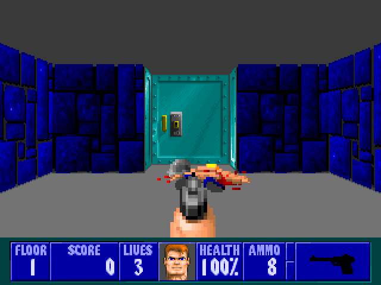
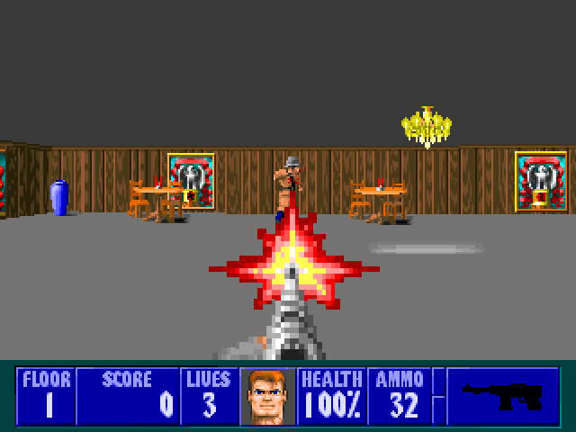
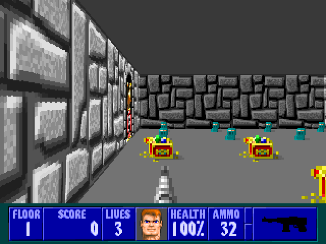

# Wolfenstein 3D for Nintendo 64

An unofficial port of id Software's Wolfenstein 3D to the Nintendo 64,
written from id's own source code. You build it from your own copy of the
game - the shareware episode, the full six-episode game, or Spear of
Destiny - and it plays the way the DOS game did, down to id's recorded demos,
which play out move for move as they do on a PC.

**Version 1.1.0**

**The easiest way to build it is in your web browser, at
<https://michaelpwest.itch.io/wolfenstein-3d-n64>:** choose your game
folder, click Build ROM, and download the ROM. There is nothing to install,
and your files are not uploaded anywhere - see
[Building in your browser](#building-in-your-browser).

None of id's game data is in this repository. The build takes it from your
copy, and the ROM it makes is for your own use only (see
[License](#license-and-what-not-to-redistribute)).

  
  
  

## What's in it

- Every floor of whichever game you build it from, with all the enemies and
  every boss - Spear of Destiny's included - and the death cam
- All four weapons, doors and keys, secret push walls, pickups, lives, and
  id's own status bar
- The music and sound effects - with the sound effects on the AdLib, or,
  as some of us first heard them, the PC Speaker
- The DOS menus: New Game, Sound, Control, Load and Save Game, Change View,
  View Scores, and in the shareware Read This!
- The screens between floors, each episode's victory and ending (Spear of
  Destiny's in pictures), and the high score table
- The title, the credits and id's four recorded demos
- A few things the DOS game didn't have: analog stick control, buttons you
  can rearrange, a map of what you've seen, and an Extras menu with the DOS
  game's cheats and a frame-rate counter

## Requirements

**Your own copy of the game** - any one of these:

| Game | Files you need |
| --- | --- |
| the shareware episode | the eight `*.WL1` files and `WOLF3D.EXE` |
| the full game, six episodes | the eight `*.WL6` files and `WOLF3D.EXE` |
| Spear of Destiny | the eight `*.SOD` files and `SPEAR.EXE` (some releases call it `WOLF3D.EXE`) |

The eight files are `VSWAP`, `GAMEMAPS`, `MAPHEAD`, `VGAGRAPH`, `VGADICT`,
`VGAHEAD`, `AUDIOT` and `AUDIOHED`. The executable is needed too: the game's
color palette and its opening screen are stored inside it, not in the data
files.

**To build it**, a desktop web browser - that's all (see
[Building in your browser](#building-in-your-browser)). Or, to build it on
your own computer instead, Node.js and a bash shell (see
[Building with build.sh](#building-with-buildsh)).

**To play it**, either:

- [ares](https://ares-emu.net/), on a computer whose graphics card supports Vulkan
  - see [Running it](#running-it), since most other emulators can't run it
- or a Nintendo 64 with a flash cart that supports SRAM saves

## Building in your browser

The easiest way. Go to the web builder:

**<https://michaelpwest.itch.io/wolfenstein-3d-n64>**

1. Click **Choose folder…** and pick the folder with your game's files - or
   drag the folder onto the page. It says which game it found, or what is
   missing.
2. Optionally, type a name for the ROM.
3. Click **Build ROM**, and when it's done, **Download**.

It takes about half a minute for the shareware and a minute or so for the
others, and a couple of seconds if you build again: the browser keeps the
converted music, even after you reload the page.

Everything happens in your browser: your game files are not uploaded
anywhere, and there is nothing to install. It needs a desktop browser -
Chrome, Edge, Firefox or Safari - as phones can't choose a folder.

You get **`Wolfenstein 3D.z64`** from the shareware or the full game, or
**`Spear of Destiny.z64`** from Spear of Destiny. The two are named
differently on purpose: emulators and flash carts keep a game's saves in a
file named after the ROM, so each game gets its own saves and high scores.

## Building with build.sh

The same build, run on your own computer - for offline use, or for
scripting it. It needs a computer running Windows, macOS or Linux, with:

- [Node.js](https://nodejs.org/), version 18 or later
- a bash shell to run `build.sh` in: the Terminal on macOS and Linux, and
  on Windows **Git Bash**, which comes with
  [Git for Windows](https://gitforwindows.org/)

The first build fetches the rest, about 8 MB, from this project's GitHub
release.

Open a terminal in this folder - Git Bash on Windows - and run:

    ./build.sh

On Windows you can double-click `build.sh` instead, once Git for Windows is
installed: it opens in a Git Bash window, which stays open at the end until
you press Enter.

It shows what the build needs, marking anything missing, and then asks what
to do:

    What would you like to do?
      1  Build the ROM                        quickest; needs only Node.js
      2  Build the ROM in your web browser    opens a page that builds it
      3  Build from the source code           with your own changes; needs Docker
      q  Quit

**Build the ROM** asks where your game files are - the `gamedata` folder
here unless you name another; keep one game per folder, and the file names
can be in capitals or not - says which game it found, asks what to call the
ROM, and builds it into this folder, as quickly as the web builder does.
Building the same game again takes a couple of seconds: the converted music
is kept, in `build/web-cache`, and reused.

**Build the ROM in your web browser** runs the web builder on your own
computer, at <http://localhost:8064>, rather than from itch.io; Ctrl+C
stops it. **Build from the source code** is described
[below](#building-from-the-source-code).

### Without the questions

Everything the menu does has an option of its own, for scripts or for
doing it again quickly:

    ./build.sh --rom                             # build what is in gamedata/
    ./build.sh --rom --data ~/games/SPEAR        # ...or in another folder

On Windows, Git Bash takes either kind of path: `--data "D:\Games\SPEAR"`
or `--data /d/Games/SPEAR`.

| Option | What it does |
| --- | --- |
| `--name "Wolfenstein 3D (full)"` | calls the ROM `Wolfenstein 3D (full).z64` instead |
| `--serve` | starts the web builder at <http://localhost:8064> and opens it in your browser; `--port` picks another port, `--no-open` leaves the browser alone |

`./build.sh --help` shows these, with examples, and what the build needs.

If `./build.sh` says "permission denied", the file lost its executable mark
on the way here - copying from Windows or out of a zip can do that. Run
`chmod +x build.sh` once, or use `bash build.sh` instead. On Windows, run
it in Git Bash rather than PowerShell or the Command Prompt, which can't
run a `.sh` file.

`build.sh` has been tested on macOS, in Git Bash on Windows and on Ubuntu
Linux.

## Building from the source code

`./build.sh` and the web builder build the ROM from a **prebuilt program**:
the port compiled once, for each release, which is the same for every game.
Your own changes to the source need compiling, and that takes **Docker**,
which holds libdragon's compiler, and Python 3. Choose **Build from the
source code** in `./build.sh`'s menu: it checks for both first, says what to
do about either one if it is missing, and checks again when you're ready -
start Docker Desktop and carry on. Then it asks what to build: the ROM, the
web builder (for a release), the automated checks, or one of two other ROMs:
one with the audio rendered rather than sequenced or synthesized, and the
benchmark.

What it needs:

- Docker, running: [Docker Desktop](https://www.docker.com/products/docker-desktop/)
  on Windows or macOS, and Docker Desktop or Docker Engine on Linux. The
  first build sets up the compiler inside it, which takes several minutes;
  later builds are much quicker.
- On Linux, Docker must work without `sudo`: add yourself to the `docker`
  group, as in Docker's
  [post-installation steps](https://docs.docker.com/engine/install/linux-postinstall/).
  The build runs the compiler as you, so what it writes - `build/` and the
  ROM - is yours.

Without the questions, these options do the same; `./build.sh --help` lists
them too:

| Option | What it does |
| --- | --- |
| `--compile` | compiles the ROM from the source; `--data` and `--name` work as with `--rom` |
| `--assets` | reads the game files in `gamedata` again, then compiles |
| `--clean` | throws away everything compiled and builds it all again; the game data already read is kept (add `--assets` to redo that too) |
| `--sim` | builds the game for your computer instead and runs its automated checks, saving pictures of the frames to `build/sim` |
| `--bench` | compiles the benchmark ROM instead of the game, `Wolfenstein 3D (benchmark).z64`: it times the renderer on a few floors and ends on a table of the results |
| `--music-wav`, `--sfx-wav` | compile the ROM with the music, or the AdLib sound effects, rendered to recordings rather than sequenced or synthesized - exact, but about 6 MB and 5 MB larger; it is named `... (rendered music).z64` and so on, so it never replaces the usual ROM |
| `--web` | makes the web builder from the source, in `build/web`, and `build/wolfenstein-3d-n64-web.zip`; needs npm too, which fetches Pyodide the first time |

With `--compile`, naming a folder reads the game from it again, so this is
how to switch from one game to another; without it, a build reuses whichever
game was read last.

`--rom` uses `build/web` when it is this version's, so after `--web` it
builds from your own program, changes and all, rather than the release's.

### Making a release

1. Set the new version in `src/wolf.h` (`PORT_VERSION`).
2. Run `./build.sh --web` after the last change.
3. Attach `build/wolfenstein-3d-n64-web.zip` to the GitHub release, under that name,
   tagged `v<version>` - say `v1.1.0`. That is where `./build.sh` fetches
   it from, so a version can't be built with it until its zip is there.
4. Upload the same zip to itch.io as an HTML5 project, for the web builder.

A ROM from the prebuilt program works exactly as one compiled here. It
isn't byte-for-byte the same, though: libdragon's music converter, built
for the browser, reserves 120 bytes more memory for each song, as a safety
margin (see
[docs/TECHNICAL_DETAILS.md](docs/TECHNICAL_DETAILS.md#the-web-builder)).

## Running it

Open the ROM in **ares**. It is the emulator recommended by libdragon, the
toolkit this port is built with, and the one the port was developed and
tested on (version 148). Turning on its **Homebrew mode** adds checks for
things that would go wrong on a real console.

Most other Nintendo 64 emulators can't run it reliably. They were made to play
commercial games, which were all built with Nintendo's own development kit,
and they take shortcuts that only work for Nintendo's code - which this port
doesn't use. What was tried:

- **simple64 v2024.12.1** runs it, but now and then freezes - sometimes
  after seconds, sometimes after many minutes. A tiny test program with none of
  the game's code in it freezes the same way, and runs cleanly on ares, so
  it isn't something in the port.
- **Mupen64Plus 2.6** and **Project64 3.0.1** don't get it running.
  libdragon's own example programs fail the same way on both, so it isn't
  something the port can change.

**On a real Nintendo 64** you need a flash cart that supports SRAM saves:
the ROM asks for 256 Kbit of battery-backed SRAM for its saves and settings.
So far it has been tested under ares, not on a console.

For more on why emulators differ here, see
[Emulators](docs/TECHNICAL_DETAILS.md#emulators) in the technical details.

## Playing

### Controls

| Input | Action |
| --- | --- |
| Analog stick / D-pad | turn and walk (the stick's sensitivity is set in Control) |
| C-left, C-right | strafe |
| R + stick / D-pad | strafe instead of turning, as holding Alt did in DOS |
| L | show or hide the map of what you have seen (the game keeps running) - on release |
| L + R | pause; only L + R again carries on (Start still opens the menu) |
| Z (trigger) | fire - hold it for the machine gun and gatling gun |
| C-up, C-down | next / previous weapon you own |
| B | run (double speed, as in the DOS game); with Control's Always Run on, walk |
| A | open a door, push a secret wall, or ride the elevator (gold doors need the gold key) |
| Start | the menu (Esc in DOS) |

Those are the defaults. **Control > Customize controls** in the menu can
give any of those actions to another button; Start always opens the menu.
The stick always does whatever the D-pad does, the menus always use A, B and
the D-pad or stick, and L + R always pauses.

### Getting around

The game opens on its sign-on screen - press a button to go on (Spear of
Destiny's moves on by itself after three seconds) - then shows the title,
the credits, the high scores and id's demos in turn. Press A, B, Z or Start
on any of them for the main menu.

- **In the menus**, up and down move the cursor, A or Start selects, and B
  goes back. In a yes/no box, A is yes and B is no.
- **Between floors**, the elevator switch shows the end-of-floor stats. A, Z
  or Start skips the count, and a second press goes on.
- **Secret floors:** each episode has a hidden elevator to a secret floor 10.
- **Ending an episode:** beat the boss on its ninth floor. Spear of Destiny
  runs as one campaign of 21 floors, two of them secret, and ends with the
  Angel of Death.
- **Text pages** (the endings and Read This!): left and right turn pages, A
  goes on, and B or Start leaves.

### Saving

Save Game and Load Game have ten slots, kept on the cartridge's
battery-backed SRAM. Your settings and the high score table are kept there
too, and saved as soon as they change. Wolfenstein and Spear of Destiny each
keep their own saves and high scores, even on a shared cartridge.

### Sound

**Sound** in the main menu chooses the sound effects - None, PC Speaker or
AdLib - and turns digitized sound and music on or off. Choosing **PC
Speaker** gives you the game as it sounded on a PC with no sound card: the
speaker's beeps, with digitized sound and music turned off, as there was
nothing to play them on. Turn either back on if you'd like it with the
beeps.

### The map and Extras

**L** shows a map of what you have seen of the floor so far. The game keeps
running while it's up.

**Extras**, in the main menu where DOS had Quit, has a frame-rate counter
and a profiler overlay, and the DOS game's cheats: God Mode, No Clip,
Health, Ammo & Keys (the M-L-I code), Free Items, Warp to Floor and End
Floor. The on/off ones - the counter, the overlay, God Mode and No Clip -
stay as you set them, even across power-off.

## More details

[TECHNICAL_DETAILS.md](docs/TECHNICAL_DETAILS.md) covers how the port works and
how closely it follows id's code: how the game data is converted, the
renderer, the enemies, sound and music, every menu screen, saved games,
where and why it departs from the DOS game, performance, and the automated
checks that play every floor and compare the demos against the original.

## License, and what not to redistribute

### The code: GPL version 2

This port is free software under the **GNU General Public License, version
2** (see `COPYING`).

It is written from id Software's 1995 source release of Wolfenstein 3D
([id-Software/wolf3d](https://github.com/id-Software/wolf3d)). That release
carries only id's "Limited Use Software License Agreement". The GPL basis is
id's later release of the game's code under the GPL: the Wolfenstein 3D
Classic iPhone source ([id-Software/Wolf3D-iOS](https://github.com/id-Software/Wolf3D-iOS),
2009, "WOLF3D iOS v2.1 GPL source release"), whose engine descends from the
DOS code through Wolf3D Redux and NewWolf. On that basis the original source
has been treated as available under the GPL - Wolf4SDL, for one, offers it
under the choice of id's license or the GPL - and this port relies on the
same reading. The iPhone release has no counterpart for some of the DOS
files this port also follows (the menus, the stats screens, the text pages,
the sound manager's rules); for those the port relies on that reading
rather than on code id itself published under the GPL.

Wolfenstein 3D is id Software's (now ZeniMax Media's), and "Wolfenstein 3D"
is their trademark. This is an unofficial port, not endorsed by either.

`tools\audio\nuked-opl3` is Nuked-OPL3 by Nuke.YKT, under the LGPL 2.1 or
later (its `LICENSE` is alongside). It is compiled into the build-time
tools (`render_audio`, `imf2xm`, `adlib_check`), and `src\adlib.c` is cut
down from it for the sound effects the
N64 synthesizes, so **that file, and the ROM it is linked into, carry the
LGPL** (see [Sound and music](docs/TECHNICAL_DETAILS.md#sound-and-music)), which the GPL is compatible with.

The web builder also carries libdragon's tools (`audioconv64`, `mkdfs`,
`n64tool`, `ed64romconfig`), which libdragon releases into the public
domain, compiled with Emscripten (MIT), and Pyodide (MPL 2.0) to run the
extractor. It lists every part's license in its `THIRD_PARTY_NOTICES.txt`.

### The data: yours, and not to be passed on

The GPL covers code, not id's game data; the iPhone release says so itself
("the game data remains subject to the original EULA and applicable law").
**None of id's game data is in this repository, and a built ROM must not be
passed on.** The build takes it from you:

- the game: `VSWAP`, `GAMEMAPS`, `MAPHEAD`, `VGAGRAPH`, `VGADICT`,
  `VGAHEAD`, `AUDIOT` and `AUDIOHED` - `.WL1` for the shareware, `.WL6` for
  the full game, `.SOD` for Spear of Destiny - and the executable
  (`WOLF3D.EXE`, or Spear of Destiny's `SPEAR.EXE`), which holds two pieces
  of artwork the data files do not: the palette and the sign-on screen. The
  extractor finds them without keeping any of either here - the palette by
  the standard EGA colors it starts with, the sign-on screen by a hash.

`tools\extract_assets.py` converts those into `wolf3d.dat`, `wolfbig.dat`
and the raw audio, which the ROM is built from - in memory, for the web
builder and `./build.sh --rom`, or into `assets\` when building from the
source. So those, and any `.z64`, are derived from id's copyrighted data:

- The shareware release could be passed on as a **complete, unmodified
  package**. A ROM holds converted, repacked pieces of it, which is neither,
  so that permission does not cover it.
- Full-game (`.WL6`) and Spear of Destiny (`.SOD`) data were sold and were
  never redistributable at all.

`.gitignore` keeps all of it out of the repository. Share the source and let
people build with their own copy of the game.
